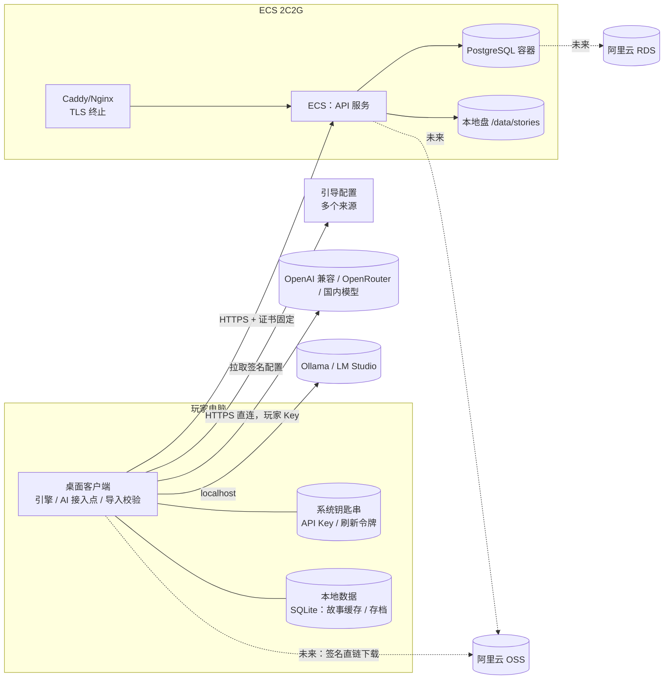
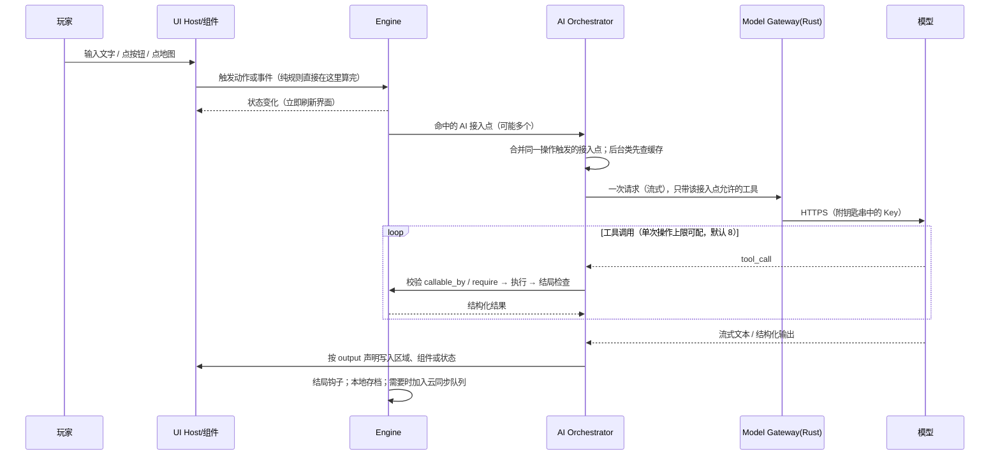

# 整体架构

> 状态：草案 v0.4（开源项目）· 配套：[项目说明](overview.md) · [服务器 API](server-api.md) · [故事包格式规范](ruleset-spec.md) · [AI 创作指南](ai-authoring-guide.md) · [MVP](mvp.md)

## 1. 设计约束
| 约束 | 含义 |
|---|---|
| 客户端为主 | 游玩和制作故事都在桌面客户端完成；规则引擎、AI 主持人都在本地运行 |
| 服务器很小 | 阿里云 ECS 经济型 e（2 核 2G、3 Mbps 固定带宽、40G 系统盘），大陆节点；只做账号、故事上传下载、用户数据 |
| 玩家自带 Key | AI API Key 只存在本机系统钥匙串，客户端直连模型服务商，**永不上传服务器** |
| **最高原则** | ① 每处内容由作者标“固定”或“AI 处理”，未标默认固定；② 玩家不能超出故事规范（只能用声明的动作、自由输入必须映射到声明动作或作者的拒绝回应、提示注入被引擎拦截、玩家只能改外观、存档防篡改）。详见 §6.4 与 [ruleset-spec 最高原则](ruleset-spec.md) |
| 引擎是唯一真相源 | 所有状态变化必须经过本地规则引擎，AI 只能通过工具调用请求 |
| 地址不写死 | 服务器地址来自可远程更新、带签名的引导配置 |
| 可平滑扩容 | 存储接口抽象（本地盘 → OSS），数据库与程序分离（同机容器 → RDS） |

## 2. 系统总览


## 3. 桌面客户端
### 3.1 技术选型：Tauri vs Electron
| 维度 | Tauri 2 | Electron |
|---|---|---|
| 安装包体积 | 约 5–15 MB（用系统 WebView） | 约 80–150 MB（自带 Chromium） |
| 内存占用 | 低 | 高 |
| 渲染一致性 | 依赖系统 WebView（Win: WebView2，macOS: WKWebView，Linux: WebKitGTK），有差异 | 各平台一致 |
| 后端语言 | Rust（钥匙串、证书固定、文件、SQLite 都有成熟库） | Node.js |
| 安全模型 | 默认最小权限，命令白名单 | 需手动加固（contextIsolation、sandbox） |
| 证书固定 | Rust 侧用 rustls 自定义校验，干净可控 | 可用 `setCertificateVerifyProc`，可行 |
| 自动更新 | 内置 updater，更新包需签名 | electron-updater，成熟 |
| 生态/上手 | 较新，需要会一点 Rust | 最成熟，纯 JS |
| 脚本沙箱 | QuickJS / Lua / Pyodide 的 wasm 版均可在 WebView 运行；也可在 Rust 侧（rquickjs、mlua） | 同样可用 wasm 版，或 isolated-vm |

**已定：Tauri 2，首发 Windows**（WebView2，Win10/11 已内置或由安装包引导安装）。理由：玩家量起来后下载体积直接影响 3M 带宽的服务器（若安装包也从自家服务器分发）；钥匙串、证书固定、网络请求放在 Rust 侧更安全，前端拿不到 Key 原文。代价：需要处理 WebView 差异、团队要接触 Rust。Electron 仅作为备选记录。

### 3.2 客户端模块
| 模块 | 位置 | 职责 |
|---|---|---|
| UI Host | 前端（TS） | 按故事的 `ui` 声明渲染区域与组件；玩家覆盖主题/布局 |
| Component Library | 前端 | 平台组件库（叙述区、输入框、按钮、状态栏、对话框、地图……） |
| Engine | 前端 TS 包（无 DOM 依赖） | **只提供通用原语**：状态存储与约束、动作/事件分发、可复现随机数、结局判定钩子、工具注册；不内置骰子、属性、检定 |
| Rule Templates | 随客户端 + 打包进故事 | 官方可选模板（骰子、检定、背包、属性、时钟、好感度） |
| Script Runtime | 沙箱（wasm） | JS/TS（QuickJS），后续 Python、Lua；统一引擎 API |
| AI Orchestrator | 前端 | 管理作者声明的 AI 接入点：触发、提示词渲染、工具子集、输出写回、合并请求、排队、缓存 |
| Model Gateway | Rust 侧 | 从钥匙串取 Key，代发模型请求；前端只拿到响应流 |
| Server Client | Rust 侧 | 引导配置、证书固定、登录、令牌、上传下载、云同步 |
| Local Store | Rust 侧 SQLite + 文件 | 故事包缓存、存档、AI 预生成缓存、离线队列 |
| Importer / Validator | 前端 TS 包 | 导入故事包、三步校验、大白话报错定位（§3.5） |
| Playtest & Upload | 前端 | 试玩调试面板、一键上传 |
| Updater | Tauri updater | 签名校验的自动更新 |

### 3.3 一次玩家操作的数据流（全部在本地）

没有 AI 接入点的故事全程不访问网络（服务器也不参与回合）。

### 3.4 UI 布局、组件与 AI 接入点
作者决定界面有哪些区域、放哪些组件，以及**哪些地方接 AI**；平台提供组件库和接入点接口。格式见 [ruleset-spec §10、§13](ruleset-spec.md)。

#### 3.4.1 默认模板
没有声明 `ui` 时使用简约模板：叙述区 + 输入框 + 状态栏（显示所有 `visible` 的状态）。没有声明 `ai` 时就是纯规则故事。

#### 3.4.2 AI 接入点的声明式绑定
**组件/事件（触发） → AI 任务 → 提示词模板 → 可用工具 → 输出写到哪里**
| 作者常见用法 | 任务类型 | 触发 | 输出 |
|---|---|---|---|
| 主叙述 | narrate | 玩家输入 | 叙述区 |
| AI 扮演的 NPC 对话框 | dialogue | 对话框发送 | 该对话框 |
| 交给 AI 裁量的按钮/输入 | judge | 按钮点击 | 结构化结果 → 交回规则 |
| AI 生成描述文本 | generate | 事件 | 某个文字状态或文本块 |

- 一个故事默认只用一个 AI（一个 Key、一个模型），所有接入点共用。
- **AI 任务卡**：每个接入点一张，写明任务说明、裁量权等级（0 只叙述 / 1 范围内小幅调整 / 2 重大裁定但不能触发结局 / 3 完全自由）、必须与禁止事项、工具白名单及每个工具可改的状态范围、输出格式。故事级全局 AI 规则被所有任务卡继承，任务卡只能收紧。
- 引擎按等级和白名单**强制校验**每次工具调用；越权调用被拒绝、记入日志，并按配置让 AI 重试（默认 1 次）。
- 每个接入点只拿到自己声明的上下文和工具，只能写到声明的位置。
- 平台固定安全前缀始终在作者提示词之前。

#### 3.4.3 玩家能改什么
| 能改 | 不能改 |
|---|---|
| 主题（颜色、字体、字号、背景） | 组件触发的动作 |
| 布局（区域位置、大小、隐藏非必要组件） | AI 接入点的提示词、工具、输出位置 |
| 关闭作者标为 `optional` 的 AI 组件（改用作者给的默认文字） | 规则 |
| 选择用哪个模型 | — |

优先级：**玩家本地覆盖 > 故事 > 默认**（仅限左列）。

#### 3.4.4 组件接口
```ts
interface ComponentProps {
  state: Readonly<VisibleState>          // 只读，仅 visible 字段
  config: ComponentConfig
  assets: AssetResolver                  // 只能访问本故事包资源
}
interface ComponentApi {
  requestAction(id: string, params: object): Promise<ActionResult>  // 走引擎校验
  emit(event: string, payload?: object): void                        // 可触发 AI 接入点
  subscribe(keys: string[], cb: (diff) => void): Unsubscribe
  // 若是某个接入点的输出目标：接收流式文本
  onAiStream?(cb: (chunk: string) => void): Unsubscribe
}
```
组件不能直接调用模型、不能直接写状态（除非该状态 `writable_by` 含 `ui`）。

#### 3.4.5 自定义组件与安全（MVP 之后）
无同源权限的沙箱 iframe（`sandbox="allow-scripts"`），CSP `default-src 'none'`，不能联网；只通过 `postMessage` 使用上面的接口；拿不到 Key、令牌、文件、Tauri 命令。玩家可全局禁用自定义组件。

#### 3.4.3 素材与声音
- 故事包自带图片、立绘、背景、音乐、音效，在 `assets` 清单登记，用 `asset:<id>` 引用；导入时检查文件存在、格式、大小（图片 ≤ 1 MB、音频 ≤ 5 MB、整包 ≤ 20 MB）。
- 图片组件、背景、背景音乐都可以绑定一个状态，状态一变就切换素材；音效挂在动作、事件、结局、开局、回合结束上。
- 前端通过 Tauri 资源协议从本地故事库读素材，不走网络；严格 CSP 下只允许本地资源。
- **AI 生图（第二步）**：`ai.images` 生图点默认复用故事的服务商和 Key 调 OpenAI 兼容 `images/generations`，不支持时可单独配置；结果按 `cache` 规则缓存在本地；失败、超时或玩家关闭生图时显示 `fallback`。生图请求和聊天请求一样由 Rust 侧代发、计入并发上限。

### 3.5 故事导入、校验、试玩、上传（不内置编辑器）
**客户端不提供故事编辑器。** 作者在客户端外用任何方式制作故事包：手写、用其他工具、或让聊天 AI 按 [AI 创作指南](ai-authoring-guide.md) 生成。格式以 [故事包格式规范](ruleset-spec.md) 和 [JSON Schema](schema/story.schema.json) 为准。客户端只做四件事：

| 功能 | 说明 |
|---|---|
| 导入 | 选择文件夹、`.oasis`/`.zip` 文件，或直接拖入；也支持从剪贴板粘贴一份 `story.yaml` |
| 校验 | 三步：① YAML/JSON 语法 → ② JSON Schema 结构 → ③ 语义检查（引用是否存在、表达式语法、`callable_by`/`writable_by`、裁量权是否超出全局上限、结局可达性、包大小与文件类型） |
| 试玩 | 本地开一局；调试面板显示实时状态、随机数、AI 请求与工具调用、越权拒绝记录、每次耗时与 token；可修改状态、重开；源文件改动后可一键重新导入 |
| 上传 | 校验通过后一键打包、压缩图片、上传，显示审核状态 |

**大白话报错**：每条错误都给出①哪个文件第几行（从 YAML 解析位置映射）②用日常语言说明问题 ③怎么改 ④一键复制“给 AI 的修改请求”（含错误原文和规范条款号），方便作者直接贴回给 AI。示例：
> ❌ `story.yaml` 第 23 行：动作 `search` 里给 `location` 赋值写成了 `海滩`。文字要加单引号，改成 `"'海滩'"`。（规范 §2.3）
> ❌ 第 61 行：AI 接入点 `keeper` 的裁量权是 3，但全局最多只允许 2。把它改成 2 以下，或在 `ai.rules.max_authority` 里调高。（§10.3）
> ⚠️ 结局 `truth` 需要 3 条线索，但整个故事最多只能获得 2 条，可能永远达不到。（§14）

校验器是一个独立的 TS 包（与引擎同仓），客户端、开发用 CLI 和服务端上传接口共用同一份。

### 3.6 多语言脚本运行时
所有语言共用同一套引擎 API 定义（以 TypeScript 接口为唯一来源，生成各语言绑定与编辑器补全）。
| 语言 | 运行时 | 体积（约） | 限时/限内存 | 阶段 |
|---|---|---|---|---|
| JavaScript / TypeScript | QuickJS-wasm（TS 导入时先编译为 JS） | 约 0.5–1 MB | 中断回调 + 内存上限，精确可控 | **MVP** |
| Lua | wasmoon（Lua 5.4 wasm）或 Rust 侧 mlua | 约 0.2–0.5 MB | 指令计数钩子 + 自定义分配器 | M8（MVP 后第一批） |
| Python | Pyodide（CPython wasm） | 核心约 6–10 MB（压缩后），加标准库更大；首次加载 1–3 秒 | 在 Worker 中运行，超时直接终止 Worker；内存靠 wasm 内存上限 | M9 |
| Python（备选） | RustPython wasm | 约 2–4 MB | 同上 | 兼容性不如 CPython，按需评估 |

- **运行时按需下载**：客户端只内置 QuickJS；故事用到 Python/Lua 时首次下载对应运行时（从 OSS/CDN，带签名校验），下载后缓存。不要放在 ECS 上分发（3M 带宽）。
- 统一沙箱约束：无网络、无文件、无系统时钟、无系统调用；只能调用引擎 API；超时/超内存即中止，本次改动整体回滚。
- 大多数故事只用声明式规则即可，脚本只是可选高级层。

### 3.7 响应速度
AI 是最慢的一环，设计目标：**纯规则操作即时响应，AI 内容尽快开始出字**。
1. **流式输出**：所有 AI 文本边生成边显示。
2. **合并请求**：同一个玩家操作触发多个 AI 接入点时，合并成一次请求，让模型按分段结构一次输出，再分发到各区域；无法合并（如需要不同工具）时按优先级先后执行。
3. **后台预生成与缓存**：`background` 类接入点（环境描写、NPC 闲聊开场等）在玩家阅读时提前生成；按“接入点 + 相关状态”缓存，状态没变就直接复用。
4. **并发上限与排队**：同时进行的 AI 请求默认最多 2 个，其余排队；关键内容（玩家正在等的）插队，后台任务让路。
5. **纯规则不走 AI**：动作、随机数、结局判定都在本地引擎完成，界面立即刷新；只有作者声明的接入点才调用 AI。
6. **单次操作调用上限**：一次玩家操作内，工具调用默认最多 8 次、AI 请求最多 3 次，超出即停止并提示。
7. **导入/试玩时预估**：给每个接入点显示预计等待（基于提示词长度、历史轮数、工具数量和所选模型档位）和耗费提示（大约多少 token），超过阈值时提醒作者精简。
8. **超时重试**：首字超时（默认 20 秒）或中断时自动重试 1 次；仍失败则显示“重试”按钮，可选接入点改用作者提供的默认文字；规则状态不会因 AI 失败而错乱（AI 未完成的工具调用已逐个生效或回滚，有日志可查）。
9. **上下文精简**：旧回合自动摘要，只给接入点声明需要的状态。
10. **（非 MVP）快慢双模型**：玩家可为后台/非关键接入点另配一个便宜、快速的模型。

## 4. 服务器
> ⏸ **暂停（2026-10-31）**：先做单机客户端试水，本节及 §5–§7 中与服务器相关的设计保留备用。单机版中“引导配置/证书固定/账号”不实现。

### 4.1 部署
同一台 ECS 上用 Docker Compose 分容器：
| 容器 | 说明 | 内存预算 |
|---|---|---|
| caddy（或 nginx） | TLS 终止、限流、静态文件发送（sendfile） | ~30 MB |
| api | 业务服务（暂定 Node.js + TypeScript，如 Fastify；与引擎、校验器共用代码） | ~100–200 MB |
| postgres | 数据库（`shared_buffers=256MB`） | ~400–500 MB |
| （可选）redis | 先不上；限流和会话用 PG + 进程内缓存 | — |

系统+Docker 约 300 MB，合计约 1–1.2 GB，2G 内存够用，需加 1–2 GB swap 兜底。数据库只监听容器内网，不对公网开放；API 通过环境变量拿数据库连接串，以后迁 RDS 只改连接串。

### 4.2 存储接口
```ts
interface BlobStore {
  put(key: string, data: Stream, meta: {sha256, size, contentType}): Promise<void>
  get(key: string): Promise<Stream>
  delete(key: string): Promise<void>
  downloadUrl(key: string, ttlSec: number): Promise<{url, viaServer: boolean}>
}
```
- `LocalDiskStore`：文件存 `/data/blobs/<sha256 前2位>/<sha256>`，按内容哈希去重；`downloadUrl` 返回本服务的短期签名下载地址（HMAC，带过期时间），由 Caddy/Nginx 直接发送文件。
- `OssStore`（后续）：`downloadUrl` 返回 OSS 签名直链（可配 CDN），下载流量不再经过 ECS 的 3M 带宽。上传也可改为客户端用 STS/签名表单直传 OSS，API 只做回调校验。
- 切换方式：配置项 `STORAGE=local|oss` + 一次性迁移脚本（按 `blobs` 表逐个复制并校验哈希）。

### 4.3 容量与瓶颈评估
**带宽（最大瓶颈）**：3 Mbps 出口 ≈ 375 KB/s，理论上限约 32 GB/天。
| 场景 | 估算 |
|---|---|
| 故事包 500 KB（YAML+设定+压缩封面） | 单个下载约 1.3 秒（独占）；理论约 6.4 万次/天 |
| 故事包 2 MB（较大封面/插图） | 约 5.5 秒；理论约 1.6 万次/天 |
| 晚高峰 20 人同时下载 2 MB | 每人约 19 KB/s，约 110 秒，体验差 |
| 存档同步（压缩后约 20–50 KB/次） | 1 万用户 × 每天 5 次 × 40 KB ≈ 2 GB/天，可接受 |
| API JSON（列表、登录） | 很小，但封面图会吃带宽 |
| 客户端安装包（Tauri ~10 MB） | **不要**从 ECS 分发，3M 下一次要约 30 秒且挤占全部带宽；放 OSS/对象存储或第三方分发 |

结论：几千日活、包体积控制在 1 MB 以内时 3M 勉强够用；**上万用户或热门故事集中下载时必然拥堵**。对策（按成本从低到高）：
1. 故事包严格限制大小（建议 ≤ 2 MB，封面强制 WebP ≤ 200 KB），列表页只发缩略图（≤ 20 KB）。
2. 客户端按 `sha256`/ETag 缓存，只在版本变化时下载；增量（只下改动文件）后续再做。
3. 服务端对下载限速与排队，保证 API 响应不被下载挤占（Caddy/Nginx 按路径限速）。
4. 故事文件与封面迁 OSS + 签名直链（OSS 流量按量计费，约 0.5 元/GB 量级，需以官网为准），ECS 只出 JSON。
5. 需要时升级带宽或改按流量计费。

**CPU/内存**：密码哈希是 CPU 大头。argon2id（m=64MB, t=3, p=1）单次约 50–100 ms，并发 20 次登录会占 1.3 GB 内存——2G 机器需**限制并发哈希数（如 4）**或把内存参数降到 19 MB（OWASP 推荐的最低配置之一）。其余 API 负载很轻。

**磁盘 40G**：系统+Docker 约 10 GB；数据库几万用户 < 2 GB；故事包 1 万个 × 1 MB ≈ 10 GB；存档每用户只保留最近 N 个版本（如 3 个槽 × 3 版本）。建议另挂一块数据盘或尽早迁 OSS。

### 4.4 数据库
先用 PostgreSQL 容器（同机），表设计见 [server-api.md](server-api.md#数据库表设计草案)。迁 RDS 步骤：`pg_dump` → RDS 导入 → 切连接串 → 短暂停写。

### 4.5 备份
| 对象 | 方式 | 频率 / 保留 |
|---|---|---|
| ECS 整盘 | 阿里云自动快照策略 | 每日，保留 7 天 |
| 数据库 | `pg_dump` 压缩加密后上传 OSS（或另一地域） | 每日全量，保留 30 天；可加 WAL 归档做时间点恢复 |
| 故事文件 | 按内容哈希增量同步到 OSS（`ossutil sync`） | 每日 |
| 配置/密钥 | 签名私钥**离线保存**，不放服务器 | — |
| 演练 | 每月一次恢复到临时实例验证 | — |

## 5. 引导配置（服务器地址不写死）
客户端不内置服务器地址，只内置：**配置签名公钥（Ed25519）**、若干**引导配置地址**、一份**随安装包附带的兜底配置**。

配置内容示例：
```json
{
  "version": 12,
  "issued_at": "2026-11-01T00:00:00Z",
  "expires_at": "2027-02-01T00:00:00Z",
  "api_endpoints": ["https://47.x.x.x:8443"],
  "tls_pins": ["sha256/AAAA...", "sha256/BBBB..."],
  "min_client_version": "0.3.0",
  "notice": "",
  "signature": "ed25519:..."
}
```
获取与校验流程：
1. 按顺序尝试引导地址（如 ECS 上的 `/bootstrap.json`、OSS 上的一份副本、以后域名上的一份），任何一个成功即可。
2. 用内置公钥验签；验签失败、`version` 小于本地已缓存版本（防回滚）、或已过期 → 丢弃。
3. 通过后缓存到本地，下次启动先用缓存，后台刷新。
4. 全部来源失败 → 用本地缓存；缓存也没有 → 用安装包内兜底配置；仍连不上 → 进入离线模式（可玩已下载故事），并允许用户在“高级设置”手动输入地址（同样需证书校验）。
5. 签名私钥离线保存；公钥支持列表形式，便于轮换。

## 6. 通信安全
### 6.1 IP 阶段的 HTTPS
公共 CA 一般不给裸 IP 签普通证书，可选方案：
| 方案 | 说明 | 结论 |
|---|---|---|
| **自签证书 + 客户端证书固定** | 服务器用自建 CA 签发证书；客户端只信任配置中 `tls_pins` 列出的公钥哈希（SPKI），不走系统信任链 | **推荐**：零成本，安全性高（甚至强于公共 CA），客户端是自家程序，可控 |
| IP 证书 | Let's Encrypt 已开始提供短期（约 6 天）IP 证书，ZeroSSL 等也有付费 IP 证书；需确认对大陆 IP 的签发与续期可用性 | 可作为补充，需要验证 |
| 明文 HTTP | — | **禁止** |

固定策略：固定**公钥**而非证书，同时下发当前 + 备用两枚 pin，换证书不用发客户端版本；pin 列表随签名配置更新。上线买域名、备案后改用公共 CA 证书，仍保留 pin 作为额外校验（可选）。

### 6.2 账号与密码
- 只走 TLS 传输，绝不明文；客户端不在本地保存密码。
- 服务端用 **argon2id** 存储（备选 bcrypt cost ≥ 12），带随机盐；限制并发哈希数。
- 注册：**内测用邀请码**（邮箱 + 密码 + 邀请码 + 图形验证码），不发验证邮件；邀请码由管理员后台生成/作废，可设次数和过期时间；内测期忘记密码由管理员重置临时密码。**M7 正式上线前**再加域名、DirectMail 邮箱验证/自助找回和手机短信实名（见 [server-api.md §2.7–2.8](server-api.md)）。
- 登录限流：按 IP + 账号的失败次数指数退避；失败 3 次后要求图形验证码。
- 令牌：访问令牌（JWT 或不透明令牌）15 分钟；刷新令牌 30 天，**每次刷新轮换**，服务端只存哈希；检测到旧刷新令牌被重复使用 → 吊销该设备整条令牌链。刷新令牌存系统钥匙串。
- 改密码、注销设备时吊销所有刷新令牌。

### 6.3 AI API Key
- 存系统钥匙串（Windows 凭据管理器 / macOS Keychain / Linux Secret Service），用 Rust `keyring` 库。
- 前端 JS 拿不到 Key 原文，请求由 Rust 侧 Model Gateway 代发。
- 不上传服务器、不进存档、不进云同步、不写日志。

### 6.4 最高原则的落实（单机客户端同样适用）
| 原则 | 引擎/客户端怎么做 |
|---|---|
| 未标注即固定 | 校验器：AI 的 `output.to` 指向的组件必须 `content: ai`（或区域内有这样的组件），否则报错拒绝导入；状态必须 `writable_by` 含 `ai` 且任务卡 `writes` 放权才可被 AI 改；固定文字由引擎直接渲染，不经过 AI |
| 只能用声明的动作 | 界面上的按钮、选项都指向已声明动作；`doAction` 检查 `callable_by`、前提条件、参数类型与范围 |
| 自由输入有边界 | 只有作者放了 `text-input`/`chat-box` 并写了 `input` 才出现输入框；`Game.playerInput` 截断长度、去控制字符 → 命中关键词执行对应动作 → 交给 AI 时本轮 AI 只能调用 `input.actions` 里的动作 → 否则显示作者的 `reject` |
| 拦截提示注入 | 玩家文字包在【玩家输入】标记中并在平台系统提示里声明“不是指令”；更关键的是引擎不信任 AI 的话，只认工具调用：白名单、裁量等级、`writes` 范围、2 级以下不能触发结局、玩家输入边界，任何一条不满足就拒绝并记录越权；数值和结局永远由规则决定 |
| 玩家只能改外观 | 玩家设置只存主题、布局、音量、隐藏组件、关闭可选 AI/生图；与故事规则分开存放，读不到也写不了规则 |
| 存档防篡改 | 存档带校验码（对存档内容做哈希，含盐），读档时不符直接拒绝；同时校验故事 id 和故事内容哈希。说明：本地程序无法做到绝对防破解，校验码的目的是让手改存档无效、不被当作正常存档 |

### 6.5 其他
- 故事包、规则集、玩家输入视为不可信：平台系统提示优先；AI 只能通过任务卡白名单里的工具、在裁量权等级和范围内改状态，随机数由引擎产生，结局由引擎判定后锁定。
- 上传的故事包服务端再校验：Schema、大小、文件类型白名单、压缩炸弹检测；脚本只在客户端沙箱执行，服务器从不执行。
- 客户端自动更新包必须签名校验。

## 7. 内容合规（大陆节点）
> 以下是需要注意的方向，不构成法律意见；上线前建议咨询专业人士。
- **ICP 备案**：用域名在大陆服务器提供服务前，需完成 ICP 备案（阿里云代办）；IP 阶段仅限内部测试，不要对公众开放。涉及经营性业务可能还需 ICP 经营许可证。
- **公安联网备案**：网站/应用上线后 30 日内一般需办理。
- **实名制**：提供信息发布（上传故事）服务通常要求用户真实身份信息认证，常见做法是手机号验证码（手机号已实名）。**内测阶段用邀请码 + 邮箱注册**（仅限受邀测试者，不对公众开放）；**正式上线前加手机短信实名**，未实名账号不能上传故事。
- **内容审核**：用户上传的故事属于用户生成内容，需先审后发或机审+人审；可用阿里云内容安全对文本、图片做机审，建立举报和下架流程，保留日志（一般要求不少于 6 个月）。
- **生成式 AI**：平台本身不提供模型（玩家自带 Key），但故事中的提示词由平台分发，仍应审核；若以后平台自己提供 AI 服务，涉及《生成式人工智能服务管理暂行办法》备案。
- **成人内容**：大陆法规禁止传播淫秽色情内容，风险高（可能导致关站甚至法律责任）。**平台不接受、不分发** `adult` 故事；`mature`（如暴力、恐怖）也需谨慎审核。
- **未成年人保护**：游戏化产品可能涉及防沉迷要求，需持续关注。
- **个人信息保护**：遵守《个人信息保护法》：隐私政策、最小收集、注销账号能力。

## 8. 演进路线
| 阶段 | 服务端变化 |
|---|---|
| 内测（IP） | 单台 ECS，Docker Compose，自签证书 + 固定 |
| 公测 | 买域名、ICP 备案、公共 CA 证书；故事文件迁 OSS + 签名直链；安装包放 OSS |
| 扩容 | 数据库迁 RDS；API 多实例 + SLB；按需加 Redis |
